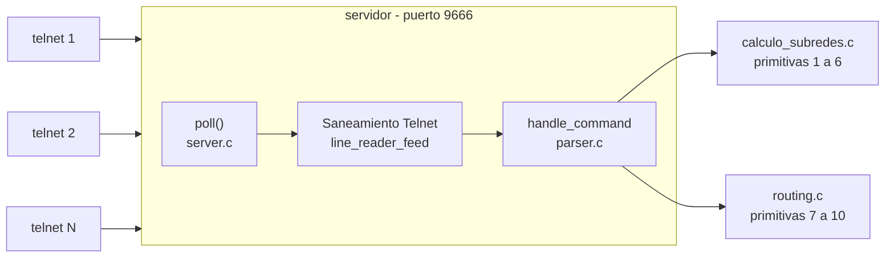
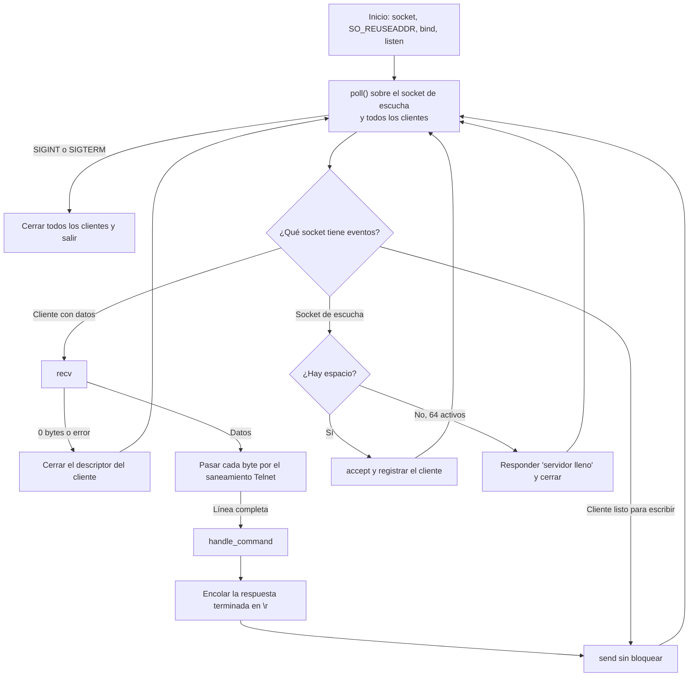

# Servidor TCP y sesiones Telnet

Responsable: Luis Diego Delgado Muñoz (tareas T-01 a T-07).

El servidor es la puerta de entrada de la calculadora. Escucha en el puerto TCP 9666, acepta varias
sesiones de `telnet` al mismo tiempo, limpia lo que escribe cada cliente y le pasa cada línea al
parser mediante `handle_command`. La respuesta del parser se devuelve al cliente tal cual, terminada
en `\r\n`.

Archivos del módulo:

| Archivo | Contenido |
| ------- | --------- |
| `calculadora_subredes/server.h` | Constantes, tipos y funciones públicas del servidor |
| `calculadora_subredes/server.c` | Socket de escucha, ciclo con `poll()`, lectura, escritura y saneamiento Telnet |
| `calculadora_subredes/main.c` | Punto de entrada: puerto, señales y arranque del servidor |
| `calculadora_subredes/prueba_server.c` | Pruebas unitarias del saneamiento de la entrada |
| `calculadora_subredes/parser_stub.c` | `handle_command` provisional que se usó antes de tener el parser real |

---

## 1. Cómo compilar y ejecutar

Requisitos: Linux o WSL con `gcc`, `make` y `telnet`. En Ubuntu se instalan con:

```bash
sudo apt-get update && sudo apt-get install -y build-essential telnet
```

Compilar y levantar el servidor desde la raíz del repositorio:

```bash
make servidor
./servidor
```

Debe aparecer `Servidor escuchando en el puerto 9666`. Opcionalmente se puede indicar otro puerto:
`./servidor 9000`.

En otra terminal, conectarse y escribir comandos:

```bash
telnet localhost 9666
```

```text
Trying 127.0.0.1...
Connected to localhost.
Escape character is '^]'.
GET IP CLASS 10.8.2.5
Clase A
GET HOSTS COUNT MASK /29
6
```

Para salir de `telnet` se presiona `Ctrl+]` y luego se escribe `quit`. El servidor se detiene con
`Ctrl+C`.

---

## 2. Arquitectura



El servidor no sabe nada de subredes. Su contrato con el resto del sistema es una sola función,
acordada con el parser desde la planificación:

```c
void handle_command(const char *input, char *output, size_t max_len);
```

`input` siempre llega como una línea limpia y terminada en `\0`, y el parser escribe la respuesta en
`output` sin pasarse de `max_len`. Gracias a eso el servidor se pudo construir y probar antes de que
existiera el parser, enlazando `parser_stub.c` en su lugar.

### Por qué `poll()` y un solo hilo

El enunciado pide atender varias sesiones a la vez. Se evaluaron hilos POSIX (un hilo por cliente) y
multiplexación de entrada/salida con `poll()`. Se escogió `poll()` porque:

- La tabla de rutas de `SET ROUTE` es compartida por todas las sesiones. Con un solo hilo no hay dos
  comandos ejecutándose al mismo tiempo, así que no hacen falta mutex ni hay condiciones de carrera.
- Todos los sockets son no bloqueantes, por lo que un cliente que no envía nada, o que envía un
  comando a medias, no detiene a los demás.
- Los cálculos son operaciones bitwise de microsegundos; no hay trabajo pesado que justifique
  repartirlo entre hilos.

---

## 3. Flujo del ciclo principal



Detalles relevantes:

- **`SO_REUSEADDR`** permite reiniciar el servidor de inmediato, sin esperar a que el sistema
  operativo libere el puerto (estado `TIME_WAIT`).
- **Máximo de 64 clientes** (`SERVER_MAX_CLIENTS`). Al cliente número 65 se le responde
  `ERROR: servidor lleno, intente mas tarde` y se cierra su conexión.
- **Escritura sin bloqueo**: si un cliente no lee sus respuestas, estas se acumulan en un buffer
  propio de ese cliente. Si el buffer se llena, se desconecta solo a ese cliente.
- **Señales**: `SIGINT` (`Ctrl+C`) y `SIGTERM`, que es la señal que envía Kubernetes al detener un
  pod, interrumpen `poll()` y el servidor cierra todas las conexiones antes de terminar. `SIGPIPE` se
  ignora para que escribirle a un cliente que ya se fue no mate el proceso.
- **Logs**: cada conexión y desconexión se imprime con la IP y el puerto del cliente. La salida
  estándar se configura línea por línea para que los mensajes aparezcan de inmediato en
  `kubectl logs`.

---

## 4. Saneamiento de la entrada Telnet

`telnet` no envía solo el texto que se escribe. Al conectarse puede negociar opciones con bytes de
control, y al final de cada línea agrega `\r\n`. Si esos bytes llegaran al parser, cualquier comando
parecería un error de sintaxis. La función `line_reader_feed` procesa la entrada byte por byte con
una pequeña máquina de estados:

| Entrada | Tratamiento |
| ------- | ----------- |
| Negociación Telnet (`IAC` = `0xFF` seguido de `WILL`, `WONT`, `DO`, `DONT` u otro comando) | Se descarta completa |
| Subnegociación (`IAC SB … IAC SE`) | Se descarta completa |
| `\r\n`, `\r\0` o `\n` | Fin de línea: la línea se entrega al parser terminada en `\0` |
| Tabulador | Se convierte en espacio |
| Otros caracteres de control y bytes no ASCII | Se descartan |
| Línea de más de 1023 caracteres | Se descarta y se responde `ERROR: comando demasiado largo`, sin cerrar la sesión |
| Línea vacía | Se ignora |

El estado se guarda por cliente, porque TCP puede partir un comando en varios segmentos: si llega
`GET NETM` y luego `ASK MASK /27\r\n`, el parser recibe el comando completo una sola vez.

---

## 5. Pruebas

### 5.1 Pruebas unitarias del saneamiento

```bash
make test_server
```

Resultado esperado:

```text
[OK] Prueba servidor: fin de linea
[OK] Prueba servidor: comando fragmentado
[OK] Prueba servidor: negociacion Telnet
[OK] Prueba servidor: caracteres de control
[OK] Prueba servidor: linea demasiado larga
Todas las pruebas del servidor pasaron
```

`make test` ejecuta estas pruebas junto con las de los demás módulos.

### 5.2 Pruebas de estabilidad y concurrencia con `telnet`

Todas parten de tener el servidor corriendo en una terminal con `./servidor`.

| # | Caso | Pasos | Resultado esperado | Resultado |
| - | ---- | ----- | ------------------ | --------- |
| 1 | Sesión básica | `telnet localhost 9666` y escribir `GET IP CLASS 10.8.2.5` | `Clase A` | Correcto |
| 2 | Varias sesiones simultáneas | Abrir tres terminales con `telnet localhost 9666` y enviar comandos en todas, alternando | Cada terminal recibe solo sus respuestas | Correcto |
| 3 | Un cliente ocioso no bloquea | Abrir una sesión y no escribir nada; en otra terminal enviar comandos | La segunda sesión responde de inmediato | Correcto |
| 4 | Cierre abrupto | Cerrar a la fuerza una terminal con `telnet` abierto (o `pkill -9 telnet`) | El servidor registra la desconexión y sigue atendiendo | Correcto |
| 5 | Comando demasiado largo | Pegar una línea de más de 1023 caracteres | `ERROR: comando demasiado largo`, y la sesión sigue funcionando | Correcto |
| 6 | Puerto ocupado | Con un servidor corriendo, ejecutar `./servidor` en otra terminal | `bind: Address already in use` y termina con código 1 | Correcto |
| 7 | Puerto inválido | `./servidor 99999` | `Puerto invalido: 99999 (debe estar entre 1 y 65535)` | Correcto |
| 8 | Detención ordenada | `Ctrl+C` o `kill -TERM <pid>` | Cierra las conexiones, imprime `Servidor detenido` y termina con código 0 | Correcto |
| 9 | Reinicio inmediato | Detener el servidor y volver a levantarlo enseguida | Arranca sin error de puerto ocupado | Correcto |

El caso 2 también se puede reproducir de forma automática. Este comando abre cinco sesiones de
`telnet` en paralelo, cada una envía diez comandos `GET BROADCAST` con IPs distintas, y al final
muestra cuántas respuestas recibió cada sesión:

```bash
for c in 1 2 3 4 5; do
  ( { sleep 0.5; for i in $(seq 1 10); do printf 'GET BROADCAST IP 10.%d.2.%d MASK /29\r\n' $c $i; sleep 0.1; done; sleep 1; } \
    | telnet localhost 9666 > /tmp/sesion.$c 2>&1 ) &
done; wait
for c in 1 2 3 4 5; do echo "sesion $c:"; tr -d '\r' < /tmp/sesion.$c | grep '^10\.' | sort | uniq -c; done
```

Resultado obtenido: cada sesión recibió exactamente sus 10 respuestas, 7 con broadcast `10.c.2.7`
(IPs `.1` a `.7`) y 3 con `10.c.2.15` (IPs `.8` a `.10`, que caen en la siguiente subred /29), sin
ninguna respuesta de otra sesión.

Adicionalmente, durante el desarrollo se probó con 20 clientes en paralelo enviando 50 comandos cada
uno, con 70 conexiones simultáneas (64 aceptadas y 6 rechazadas con `servidor lleno`) y se verificó
con `ls /proc/<pid>/fd` que, después de cerrar todas las sesiones, el proceso solo conserva sus
descriptores base: entrada, salida, error y el socket de escucha.

---

## 6. Conclusiones

1. Separar el servidor del parser mediante una única función, `handle_command`, permitió construir y
   probar la parte de red antes de que existieran los demás módulos, y después integrarlos sin
   cambiar el servidor.
2. Con `poll()` en un solo hilo se atienden varias sesiones simultáneas sin mecanismos de
   sincronización. Como los cálculos son muy rápidos, ningún cliente nota que los comandos se
   ejecutan uno a la vez, y la tabla de rutas compartida queda protegida de forma natural.

## 7. Recomendaciones

1. Tratar todo lo que llega por el socket como bytes crudos y no como texto: `telnet` envía
   negociación y fines de línea propios, y TCP puede partir o juntar comandos. Conviene limpiar la
   entrada en un solo lugar, antes del parser, y probar ese saneamiento con pruebas unitarias.
2. Manejar `SIGTERM` y cerrar las conexiones de forma ordenada en cualquier servidor que se vaya a
   desplegar en contenedores, porque Kubernetes envía esa señal al detener un pod y, si se ignora,
   termina el proceso a la fuerza tras el período de gracia.

---

## Referencias

- Postel, J. y Reynolds, J. (1983). *RFC 854: Telnet Protocol Specification*. IETF.
  https://www.rfc-editor.org/rfc/rfc854
- Kerrisk, M. *poll(2)*, *socket(7)* y *tcp(7)*. Linux man-pages project.
  https://man7.org/linux/man-pages/
- Hall, B. (Beej). *Beej's Guide to Network Programming*. https://beej.us/guide/bgnet/
